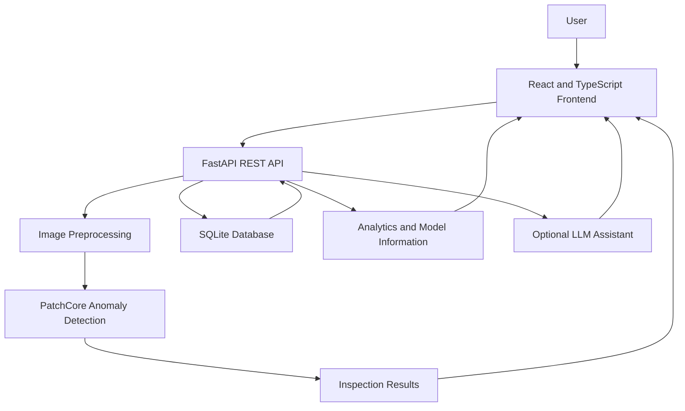

# VisionInspect AI — Industrial Surface Inspection & Defect Analytics Platform

VisionInspect AI is an AI-powered industrial surface inspection platform designed to identify potential defects in product images, visualize anomaly regions, and present inspection results through an analytics dashboard.

The project combines **PatchCore-based anomaly detection, computer vision, a FastAPI backend, and a React dashboard** to explore how AI can support automated quality inspection in industrial environments.

> **Project status:** Developed as an AI/ML portfolio project. Model performance varies by defect category, and the platform has not been validated for production factory use.

## Overview

Traditional quality inspection can be time-consuming and may depend heavily on manual visual examination. VisionInspect AI explores an alternative approach: learning patterns from defect-free product images and identifying visual deviations that may indicate anomalies.

The platform currently supports five MVTec AD categories: metal nut, bottle, cable, screw, and transistor.

## Key Features

- **AI-based anomaly detection:** Uses PatchCore with a PyTorch feature-extraction backbone.
- **Multi-category inspection:** Supports five configured industrial object categories.
- **Visual inspection workflow:** Provides a frontend for interacting with inspection functionality.
- **Inspection history:** Includes backend endpoints for retrieving inspection records.
- **Analytics endpoints:** Exposes summary and model-performance data for dashboard integration.
- **Model information:** Provides endpoints for model details and supported categories.
- **AI assistant integration:** Includes a configurable backend assistant using Gemini or OpenAI, subject to configuration and API-key availability.
- **REST API:** Uses FastAPI to connect the frontend with backend inspection and analytics functionality.

## Technology Stack

| Layer | Technologies |
|---|---|
| Frontend | React 19, TypeScript, Vite |
| UI and visualization | Tailwind CSS, Lucide React, Recharts, Motion |
| Backend | Python, FastAPI, Pydantic |
| Machine learning | PyTorch, PatchCore, Wide ResNet-50-2 |
| Image processing | OpenCV, Pillow, NumPy |
| Data and persistence | SQLite, SQLAlchemy |
| Evaluation | scikit-learn, NumPy |
| Optional AI assistant | Google Gemini / OpenAI |

## System Architecture



The frontend communicates with the FastAPI backend through REST endpoints. The backend handles image inspection, model interaction, persistence, and analytics. The optional language-model assistant is configured separately from the core PatchCore inspection workflow.

## Supported Categories

| Category | Description |
|---|---|
| `metal_nut` | Metal nut surface inspection |
| `bottle` | Bottle surface inspection |
| `cable` | Cable defect inspection |
| `screw` | Screw surface inspection |
| `transistor` | Transistor surface inspection |

The default PatchCore backbone is `wide_resnet50_2`, and the training script uses a default coreset ratio of `0.10`.

## Project Structure

```text
visioninspect-ai/
├── backend/
│   ├── app/
│   │   ├── api/
│   │   │   └── routes/
│   │   ├── core/
│   │   ├── db/
│   │   └── ml/
│   ├── artifacts/
│   │   ├── evaluation/
│   │   ├── inspections/
│   │   └── models/
│   ├── data/
│   │   └── mvtec_ad/
│   ├── scripts/
│   │   ├── download_dataset.py
│   │   ├── prepare_dataset.py
│   │   ├── train_model.py
│   │   └── evaluate_model.py
│   ├── tests/
│   └── requirements.txt
├── src/
├── package.json
├── pyproject.toml
└── README.md
```

This is a high-level representation of the repository; additional files and folders may exist.

## Getting Started

### Prerequisites

Install the following before running the project:

- Python 3.12
- Node.js and npm
- Git
- A compatible environment for PyTorch

The backend has CPU as the default training device, so a GPU is not required by the training script.

### 1. Clone the repository

```bash
git clone <YOUR_GITHUB_REPOSITORY_URL>
cd visioninspect-ai
```

Replace the placeholder with your repository URL after creating it.

### 2. Set up the backend

From the project root, create and activate a Python virtual environment:

```powershell
py -3.12 -m venv .venv
.\.venv\Scripts\Activate.ps1
```

Install the backend dependencies:

```powershell
python -m pip install --upgrade pip
pip install -r backend/requirements.txt
```

**Dependency note:** The current configuration imports `pydantic_settings`, but `pydantic-settings` is not explicitly listed in `backend/requirements.txt`. Ensure this dependency is added to the requirements before relying on a clean installation.

### 3. Configure environment variables

Create a `.env` file in the project root if you intend to use the optional AI assistant.

Example:

```dotenv
LLM_PROVIDER=gemini
GEMINI_API_KEY=your_gemini_api_key
LLM_MODEL=gemini-2.5-flash
```

Keep API keys private. Never commit `.env` to GitHub.

The backend configuration also defines an OpenAI API key and supports a `none` provider option. Verify the provider-specific requirements in the implementation before switching providers.

### 4. Start the backend

The backend application entry point should be verified in `backend/app/main.py` before using the following example:

```powershell
uvicorn backend.app.main:app --host 127.0.0.1 --port 8000 --reload
```

If the entry point differs, adjust the module path accordingly.

The configured API prefix is `/api`. Once the backend is running, the health endpoint is expected at:

```text
http://127.0.0.1:8000/api/health
```

### 5. Set up and start the frontend

Open a second terminal at the project root:

```powershell
npm install
npm run dev
```

The Vite development server is configured for port `3000`.

Open:

```text
http://localhost:3000
```

If installation or startup fails, check the Node.js version and the dependency error before trying alternative installation flags.

## Dataset Setup

VisionInspect AI is configured to use the **MVTec Anomaly Detection (MVTec AD)** dataset.

Obtain the dataset from the official source:

- [MVTec AD Dataset](https://www.mvtec.com/company/research/datasets/mvtec-ad)

The dataset should be available under:

```text
backend/data/mvtec_ad/
```

The expected category structure includes training images from the `train/good` directory and test images under `test`, with corresponding ground-truth masks under `ground_truth` for evaluation.

Use the supplied scripts to download or prepare the dataset, after checking their command-line arguments:

```powershell
python backend/scripts/download_dataset.py
python backend/scripts/prepare_dataset.py
```

The dataset has licensing restrictions, including non-commercial-use conditions. Review the dataset's current license and terms before using it. Do not redistribute the dataset or commit its images to your repository.

## Model Training

The training script supports individual categories or all configured categories.

Train one category:

```powershell
python backend/scripts/train_model.py --category metal_nut
```

Train all supported categories:

```powershell
python backend/scripts/train_model.py --all
```

Specify a different coreset ratio:

```powershell
python backend/scripts/train_model.py --category metal_nut --coreset-ratio 0.10
```

The script defaults to the `wide_resnet50_2` backbone and CPU execution. Training can take time because image features are extracted before the PatchCore memory bank is constructed.

Existing model checkpoints are stored under:

```text
backend/artifacts/models/
```

The training commands are provided for reproducibility. **You do not need to retrain existing models simply to run or document the project.**

## Model Evaluation

Evaluate one category:

```powershell
python backend/scripts/evaluate_model.py --category metal_nut
```

Evaluate all supported categories:

```powershell
python backend/scripts/evaluate_model.py --all
```

Evaluation depends on the relevant dataset files and a trained checkpoint being available.

The evaluation script reports metrics including pixel-level AUROC, precision, recall, F1 score, and an optimal threshold. Results should be interpreted separately for each category. No numerical benchmark claims are included here because the corresponding saved evaluation reports have not been independently verified for this README.

## API Endpoints

The backend defines the following routes under the `/api` prefix:

| Method | Endpoint | Purpose |
|---|---|---|
| `GET` | `/api/health` | Backend health information |
| `POST` | `/api/inspect` | Submit an image for inspection |
| `GET` | `/api/inspections` | Retrieve inspection records |
| `GET` | `/api/inspections/{inspection_id}` | Retrieve a specific inspection |
| `GET` | `/api/analytics/summary` | Retrieve analytics summary |
| `GET` | `/api/analytics/performance` | Retrieve evaluation metrics |
| `GET` | `/api/model-info` | Retrieve model information |
| `GET` | `/api/categories` | Retrieve supported categories |
| `POST` | `/api/assistant/chat` | Send a message to the assistant |

Request bodies, response schemas, and optional parameters are defined in the corresponding backend route files.

## Testing

The repository contains a backend test directory. Run the test suite from the project root:

```powershell
python -m pytest backend/tests -v
```

Run the frontend TypeScript check:

```powershell
npm run lint
```

Build the frontend:

```powershell
npm run build
```

A successful test or build command provides evidence for that specific check; it does not, by itself, establish production readiness or guarantee model accuracy.

## Limitations

- Anomaly detection performance varies across product categories.
- Model evaluation depends on the dataset, ground-truth masks, thresholds, and evaluation procedure.
- The project has not been validated as a production industrial quality-control system.
- Local dataset files, trained checkpoints, and database contents may not be present in a fresh clone.
- The optional LLM assistant requires the appropriate configuration and credentials.
- Results from a benchmark dataset may not generalize to unseen factory conditions, lighting, cameras, or materials.

## Future Improvements

- Improve and systematically compare category-specific model performance.
- Add clearer evaluation reports and reproducible benchmark summaries.
- Expand test coverage and document API request and response examples.
- Improve deployment configuration and portability.
- Add stronger operational monitoring, error handling, and security checks.
- Validate the system on representative real-world industrial data before any production use.

## Acknowledgments

- **MVTec AD** for the industrial anomaly-detection benchmark dataset.
- The developers and researchers behind PyTorch, PatchCore, FastAPI, React, and the supporting open-source ecosystem.

## Author

**Rashmita Perumanla**

- [LinkedIn](https://linkedin.com/in/rashmita-perumanla)

---

*VisionInspect AI is an educational and portfolio project exploring computer vision, anomaly detection, and analytics for industrial inspection.*